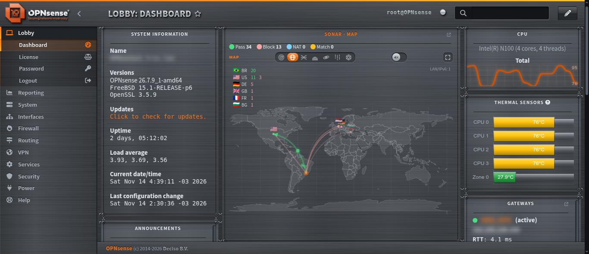
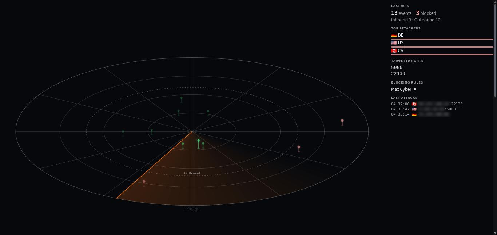
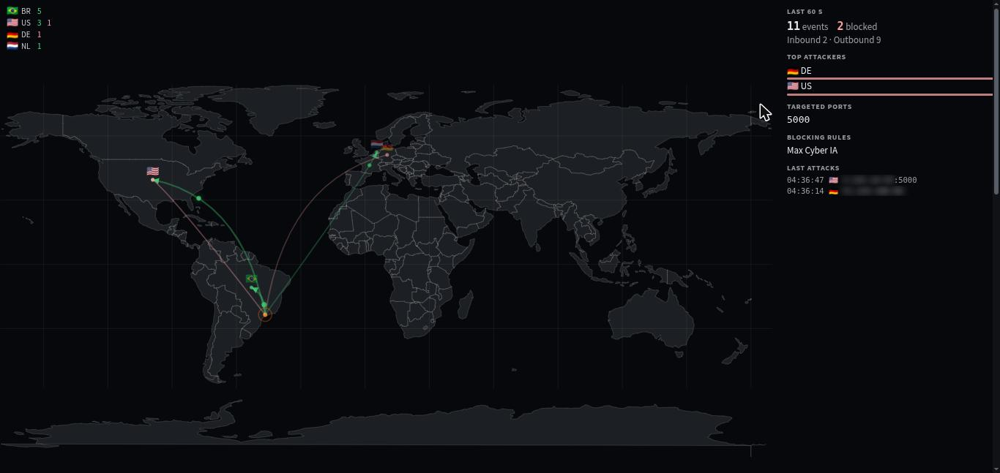
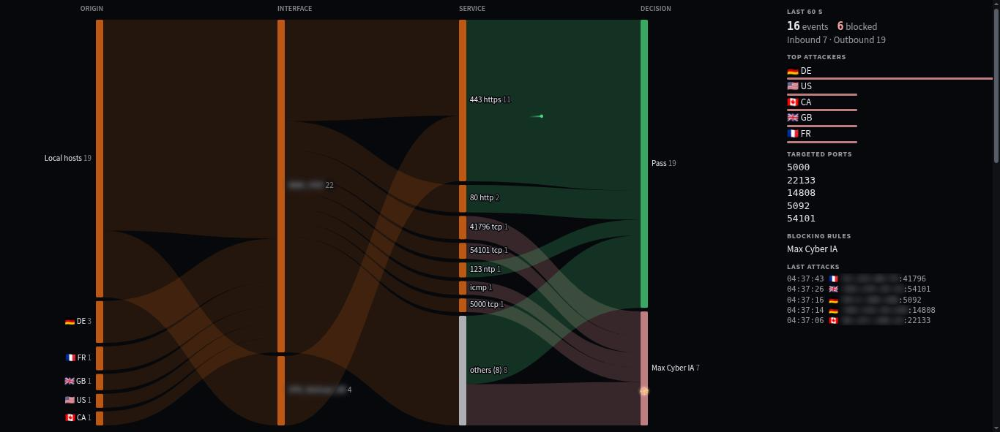
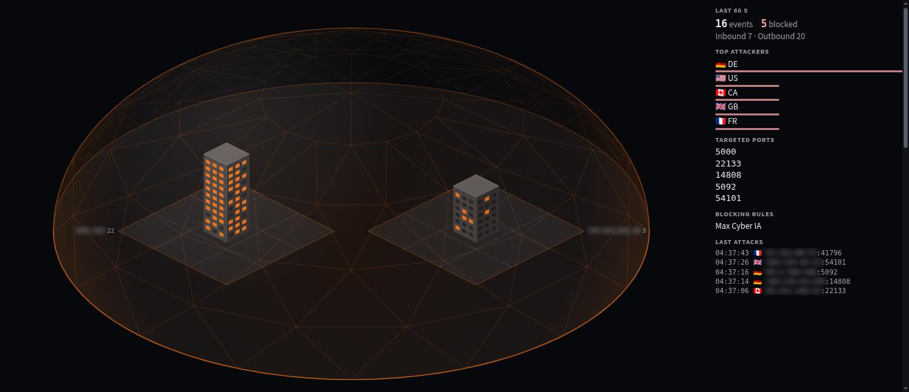
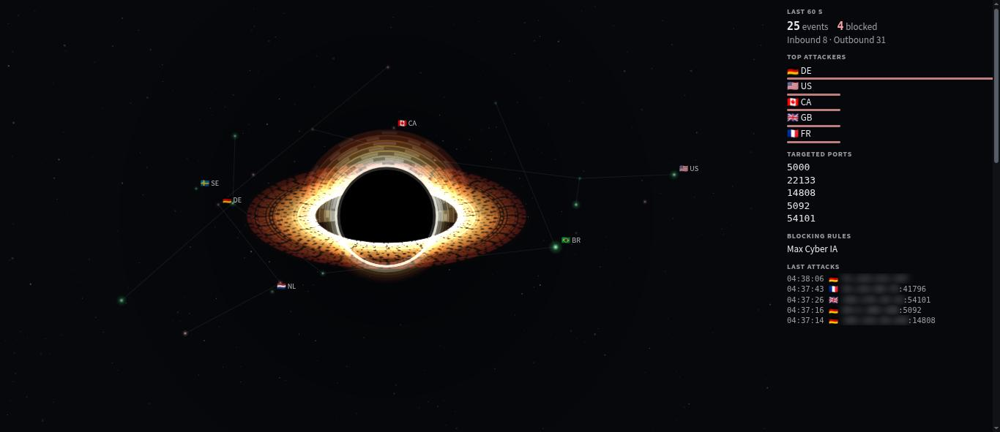
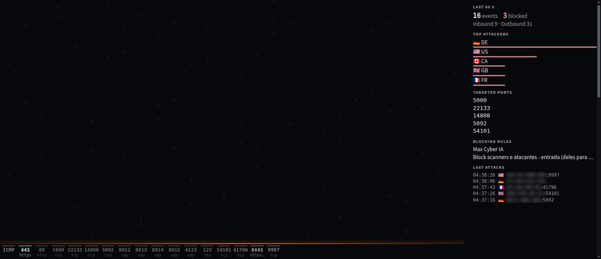

# OPNsense widget: Sonar

A dashboard widget for OPNsense that visualizes the live firewall log: a radar, a world map with the remote
countries, a flow view (origin › interface › service › decision) and other full-screen views made for a monitoring
screen or a TV.

Made to celebrate 10 years of OPNsense, as a thank-you to the project and its community. Proposed upstream in
[opnsense/plugins#5922](https://github.com/opnsense/plugins/issues/5922).

> Independent project, not affiliated with or supported by the OPNsense project or Deciso B.V.

## Screenshots

| | |
|---|---|
|  |  |
|  |  |
|  |  |
|  | |

The dark look in the screenshots is the separate [Forja theme](https://github.com/igortoledo007/opnsense-theme-forja);
the widget works with any theme. Addresses and interface names in the screenshots are blurred.

## What it shows

- **Radar, map, flow** and the **Citadel, Black hole and Digital rain** views, with a compact view selector, a
  full-screen button and an optional sound mode.
- Last 60 s summary: events, blocked, inbound/outbound, top attacking countries, targeted ports, blocking rules and
  the last attacks (click opens the event in Firewall › Log Files › Live View).
- **Max Cyber view** (optional): threat level, exposure and an AI brief, only when the
  [Policy Analyzer](https://github.com/igortoledo007/opnsense-policyanalyzer) plugin is installed (it reads
  `/api/policyanalyzer/ai/brief`). Without it the view says so and the other views work normally.

It only reads data through the standard OPNsense API (`/api/diagnostics/firewall/stream_log`, interface names, CPU,
traffic and system resources). It never changes anything on the firewall.

## Requirements

- OPNsense 26.7 or later (tested on 26.7.9, amd64).
- **Country data (optional, free)**: for the map and the country flags, configure GeoIP with your own free MaxMind
  account, as in the [official how-to](https://docs.opnsense.org/manual/how-tos/maxmind_geo_ip.html) (Firewall ›
  Aliases › GeoIP settings), then build the widget's country table on the firewall (see below). The table is not
  included in this repository because the GeoLite2 license does not allow redistributing it. Without it the map still
  draws and the routes simply have no country.

## Installation

**As a package (recommended)**, on a FreeBSD/OPNsense build host with the official plugins tree:

```sh
git clone https://github.com/opnsense/plugins.git
git clone https://github.com/igortoledo007/opnsense-widget-sonar.git
cp -R opnsense-widget-sonar/widget-sonar plugins/misc/widget-sonar
cd plugins/misc/widget-sonar
make package        # -> work/pkg/os-widget-sonar-<version>.pkg
```

Copy the package to the firewall and install it with `pkg add ./os-widget-sonar-<version>.pkg`.

**Manual copy (test boxes):**

```sh
scp widget-sonar/src/opnsense/www/js/widgets/Sonar*.js widget-sonar/src/opnsense/www/js/widgets/Sonar-map.json \
    root@<firewall>:/usr/local/opnsense/www/js/widgets/
scp widget-sonar/src/opnsense/www/js/widgets/Metadata/Sonar.xml root@<firewall>:/usr/local/opnsense/www/js/widgets/Metadata/
scp -r widget-sonar/src/opnsense/scripts/sonar root@<firewall>:/usr/local/opnsense/scripts/
```

**Country table**, on the firewall, after GeoIP has downloaded its lists (repeat after each GeoIP update):

```sh
python3 /usr/local/opnsense/scripts/sonar/build-geo.py /usr/local/share/GeoIP/alias \
    /usr/local/opnsense/www/js/widgets/Sonar-geo.bin
```

Then open **Lobby › Dashboard**, click the pencil (edit), add **Sonar** and save. Reload the page if the widget does
not appear in the list.

## Removal

Remove the widget from the dashboard, then `pkg delete os-widget-sonar`, or delete
`/usr/local/opnsense/www/js/widgets/Sonar*`, `/usr/local/opnsense/www/js/widgets/Metadata/Sonar.xml` and
`/usr/local/opnsense/scripts/sonar` if they were copied by hand.

## Layout

```
widget-sonar/                         plugin directory for the opnsense/plugins tree (misc/widget-sonar)
  Makefile, pkg-descr
  src/opnsense/www/js/widgets/        Sonar.js and its view modules, Sonar-map.json (Natural Earth 1:110m, public domain)
  src/opnsense/www/js/widgets/Metadata/Sonar.xml   widget registration, API endpoints and translations
  src/opnsense/scripts/sonar/build-geo.py          builds Sonar-geo.bin from the firewall's own GeoIP lists
screenshots/
```

## AI disclosure

Written with AI assistance: Claude (Anthropic), a mix of the Fable 5.2 and Opus 5.5 models. I reviewed and tested it
on my own firewall and I maintain it.

## License

BSD 2-Clause, see [LICENSE](LICENSE). Map data: Natural Earth (public domain). OPNsense® is a registered trademark of
Deciso B.V.
